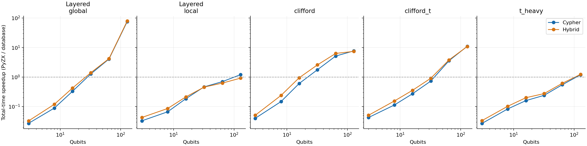
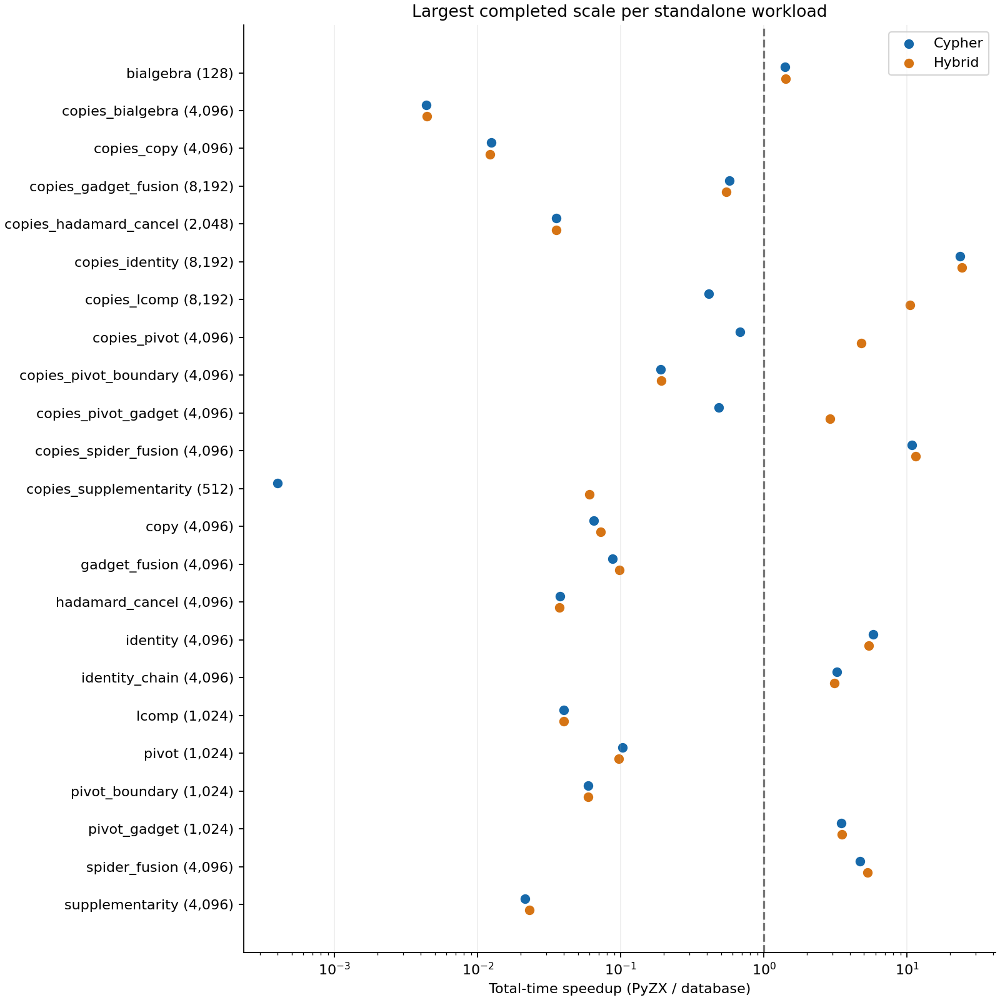
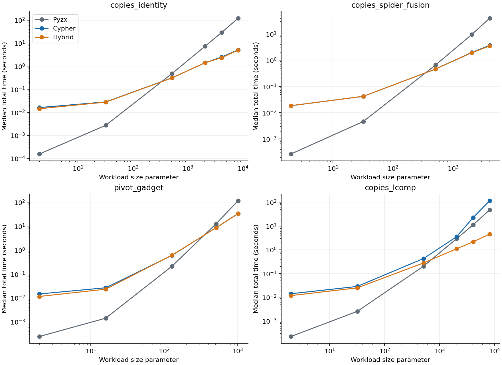

# Final benchmark results — 29 October 2026

Paper figures are available in [the compiled preview](paper-figures/main.pdf)
and [the complete figure bundle](paper-figures.zip), including rewrite-only and
total-time TikZ snippets, cropped vector PDFs, and exact plotted data. All five
circuit families reach 128 qubits; each curve ends at its last contiguous
completed comparison. See [figure coverage and captions](paper-figures/README.md).

Campaign stopped at the user's request at 2026-10-29T21:23:20.204949+00:00. No benchmark or cutoff monitor remains active. The dedicated database was cleaned of the interrupted graph and stopped.

**Main finding:** database batching produces substantial full-reduce speedups at 128 qubits and strong wins for selected large individual rules. It does not produce universal standalone-rule superiority. Import/export overhead often removes rewrite-only wins.

## Coverage

| Outcome | Configurations |
| --- | --- |
| budget_skipped | 6 |
| complete | 210 |
| finalization_interrupted | 1 |
| memory_failure | 2 |
| not_run | 23 |
| skipped | 13 |
| user_interrupted | 2 |

90 completed circuit configurations and 120 completed standalone-rule configurations; 1,890 measured engine trials, plus one warmup per engine per completed configuration. All 90 circuit configurations at 3–128 qubits completed. No 256-qubit circuit configuration completed.

The full planned grid contained 257 configurations. All 28 workload shapes were exercised, but the largest planned sizes were not all reached. Cases marked not_run were never started; interrupted and skipped cases retain partial observations but contribute no paired timing medians.

## Full reduce at 128 qubits

Speedup = PyZX time / database time; values above one favor the database. Entries are geometric means of three per-seed median ratios. Each median uses three measured repetitions. Total time includes import/rewrite/export; PyZX total includes graph copying.

| Family | Cypher rewrite | Hybrid rewrite | Cypher total | Hybrid total |
| --- | --- | --- | --- | --- |
| layered_global | 94.5× | 98.3× | 75.2× | 78.2× |
| layered_local | 1.54× | 1.14× | 1.2× | 0.917× |
| random_clifford | 8.06× | 7.73× | 7.66× | 7.38× |
| random_clifford_t | 13.8× | 12.7× | 11× | 10.8× |
| random_t_heavy | 1.52× | 1.59× | 1.19× | 1.23× |

At 128 qubits Cypher wins 15/15 rewrite and 15/15 total-time configurations. Hybrid wins 15/15 rewrite and 13/15 total-time configurations. The two hybrid total-time losses are local-layered inputs.

## Largest completed size of each standalone workload

These are the largest **completed**, not largest planned, sizes. Sizes mean motif copies for copies_* workloads, chain length for identity_chain, and the generator size parameter otherwise. Different families therefore have different graph sizes. These selected largest sizes are not a common-size comparison.

| Workload | Size | Cypher rewrite | Hybrid rewrite | Cypher total | Hybrid total |
| --- | --- | --- | --- | --- | --- |
| bialgebra | 128 | 2.01× | 2.06× | 1.4× | 1.42× |
| copies_bialgebra | 4096 | 0.00427× | 0.00433× | 0.00437× | 0.00443× |
| copies_copy | 4096 | 0.0116× | 0.0113× | 0.0125× | 0.0122× |
| copies_gadget_fusion | 8192 | 9.54× | 9.36× | 0.572× | 0.545× |
| copies_hadamard_cancel | 2048 | 0.0353× | 0.0354× | 0.0353× | 0.0354× |
| copies_identity | 8192 | 411× | 412× | 23.5× | 24× |
| copies_lcomp | 8192 | 0.426× | 190× | 0.411× | 10.4× |
| copies_pivot | 4096 | 0.775× | 57.2× | 0.678× | 4.78× |
| copies_pivot_boundary | 4096 | 1.92× | 2.73× | 0.189× | 0.191× |
| copies_pivot_gadget | 4096 | 0.579× | 44× | 0.485× | 2.9× |
| copies_spider_fusion | 4096 | 125× | 119× | 10.8× | 11.4× |
| copies_supplementarity | 512 | 0.000218× | 0.0447× | 0.0004× | 0.0605× |
| copy | 4096 | 0.756× | 0.697× | 0.0649× | 0.0722× |
| gadget_fusion | 4096 | 0.128× | 0.141× | 0.0873× | 0.0972× |
| hadamard_cancel | 4096 | 0.0376× | 0.0374× | 0.0375× | 0.0373× |
| identity | 4096 | 112× | 95.2× | 5.77× | 5.41× |
| identity_chain | 4096 | 7.75× | 7.77× | 3.24× | 3.09× |
| lcomp | 1024 | 0.974× | 0.9× | 0.0398× | 0.0398× |
| pivot | 1024 | 2.36× | 1.04× | 0.103× | 0.097× |
| pivot_boundary | 1024 | 1.3× | 1.25× | 0.0592× | 0.0588× |
| pivot_gadget | 1024 | 76.2× | 71.7× | 3.46× | 3.5× |
| spider_fusion | 4096 | 62.3× | 61.5× | 4.69× | 5.3× |
| supplementarity | 4096 | 0.0204× | 0.022× | 0.0214× | 0.023× |

Across these 23 workload shapes, Cypher wins 11/23 on rewrite and 7/23 on total time; hybrid wins 14/23 and 10/23 respectively.

- Identity copies at 8,192 show about 411–412× rewrite and 23–24× total-time speedups. Spider-fusion copies at 4,096 show about 119–125× rewrite and 11× total-time speedups.
- Gadget-pivot fans at size 1,024 show about 72–76× rewrite and 3.5× total speedups. This is a particularly clear case where the larger workload reveals an end-to-end database advantage.
- For 8,192 local-complementation copies, hybrid wins about 190× on rewrite and 10.4× on total time; pure Cypher loses. The native implementation materially changes this result.
- For 8,192 gadget-fusion copies, both database variants win about 9× on rewrite but lose on total time. Graph transport dominates the benefit.
- Disjoint bialgebra, copy, Hadamard cancellation and supplementarity remain poor database workloads in this campaign. Larger inputs did not rescue them. Dense bialgebra at sizes 512 and 1,024 exceeded available memory.

## Correctness, integrity, and interpretation

- All 88 selected live regression tests passed. Of 446 fixture checks (223 inputs × two database modes), 440 verified and six remained inconclusive; none failed. No supplemental proof campaign was performed for those six in this run.
- Completed measured outputs have input-semantic check counts: `{"cypher": {"inconclusive": 492, "verified": 138}, "hybrid": {"inconclusive": 492, "verified": 138}, "pyzx": {"inconclusive": 492, "verified": 138}}`. Inconclusive does not mean correct. Structural differences and degree-sequence agreement are not semantic certificates.
- The timed engine code, workload generators, and verification sources match the original campaign hashes across every case. The finalizer checks exact repetition completeness and publishes its integrity results.
- Limits changed during the campaign: initially two hours per engine; then 30 minutes for warmups, then for all engine runs; finally five minutes for all engine runs. The external cutoff includes verification before the completion event and polls every five seconds. Therefore the result set is censored by changing budgets, not an unbiased comparison at one fixed limit.
- Long measurements completed before a policy change are retained. For example, copies_bialgebra at 4,096 completed a Cypher repetition in about 55 minutes while its median was about 13.5 minutes. Per-repetition min/max timings in the CSV expose this variability; the cause was not established.
- Local-layered seed labels generate identical inputs; do not treat them as three independent circuit instances. Deterministic synthetic rule workloads also do not establish population-level confidence intervals.
- No claim of asymptotic superiority or fully verified semantics for the large workloads follows from these timings. Curves show observed finite-size scaling; favorable cases should be presented together with losses and memory/cutoff outcomes.

## Incomplete and skipped cases

| Index | Workload | Size | Outcome |
| --- | --- | --- | --- |
| 90 | layered_global | 256 | user_interrupted |
| 91 | layered_global | 256 | user_interrupted |
| 92 | layered_global | 256 | skipped |
| 93 | layered_local | 256 | skipped |
| 94 | layered_local | 256 | skipped |
| 95 | layered_local | 256 | skipped |
| 96 | random_clifford | 256 | skipped |
| 97 | random_clifford | 256 | skipped |
| 98 | random_clifford | 256 | skipped |
| 99 | random_clifford_t | 256 | skipped |
| 100 | random_clifford_t | 256 | skipped |
| 101 | random_clifford_t | 256 | skipped |
| 102 | random_t_heavy | 256 | skipped |
| 103 | random_t_heavy | 256 | skipped |
| 104 | random_t_heavy | 256 | skipped |
| 163 | bialgebra | 512 | memory_failure |
| 186 | bialgebra | 1024 | memory_failure |
| 207 | copies_supplementarity | 2048 | budget_skipped |
| 212 | copies_hadamard_cancel | 4096 | budget_skipped |
| 219 | copies_supplementarity | 4096 | budget_skipped |
| 227 | copies_bialgebra | 8192 | budget_skipped |
| 228 | copies_copy | 8192 | budget_skipped |
| 230 | copies_hadamard_cancel | 8192 | budget_skipped |
| 233 | copies_pivot | 8192 | finalization_interrupted |
| 234 | copies_pivot_boundary | 8192 | not_run |
| 235 | copies_pivot_gadget | 8192 | not_run |
| 236 | copies_spider_fusion | 8192 | not_run |
| 237 | copies_supplementarity | 8192 | not_run |
| 238 | identity_chain | 8192 | not_run |
| 239 | copies_bialgebra | 16384 | not_run |
| 240 | copies_copy | 16384 | not_run |
| 241 | copies_gadget_fusion | 16384 | not_run |
| 242 | copies_hadamard_cancel | 16384 | not_run |
| 243 | copies_identity | 16384 | not_run |
| 244 | copies_lcomp | 16384 | not_run |
| 245 | copies_pivot | 16384 | not_run |
| 246 | copies_pivot_boundary | 16384 | not_run |
| 247 | copies_pivot_gadget | 16384 | not_run |
| 248 | copies_spider_fusion | 16384 | not_run |
| 249 | copies_supplementarity | 16384 | not_run |
| 250 | copy | 16384 | not_run |
| 251 | gadget_fusion | 16384 | not_run |
| 252 | hadamard_cancel | 16384 | not_run |
| 253 | identity | 16384 | not_run |
| 254 | identity_chain | 16384 | not_run |
| 255 | spider_fusion | 16384 | not_run |
| 256 | supplementarity | 16384 | not_run |

## Files

- `timings.csv` / `timings.json`: complete-case medians, min/max repetition times, active/no-op flags and paired ratios for every planned configuration.
- `observations.jsonl`: frozen union of engine-level and enriched comparison observations, including partial cases. Case index and source directory are included.
- `outcomes.json`: explicit classification and failure reasons for every configuration.
- `summary.json`, `integrity.json`, `evidence-manifest.json`: machine-readable findings and hashes of source evidence.
- PNG and SVG figures: circuit total-speedup curves, largest completed rule speeds, and selected total-runtime scaling. These show medians/geometric means, not confidence intervals.
- Original raw logs, graph snapshots and source archives remain in `../cases/`; correctness evidence remains in `../correctness/`. Earlier campaigns were not pooled.
