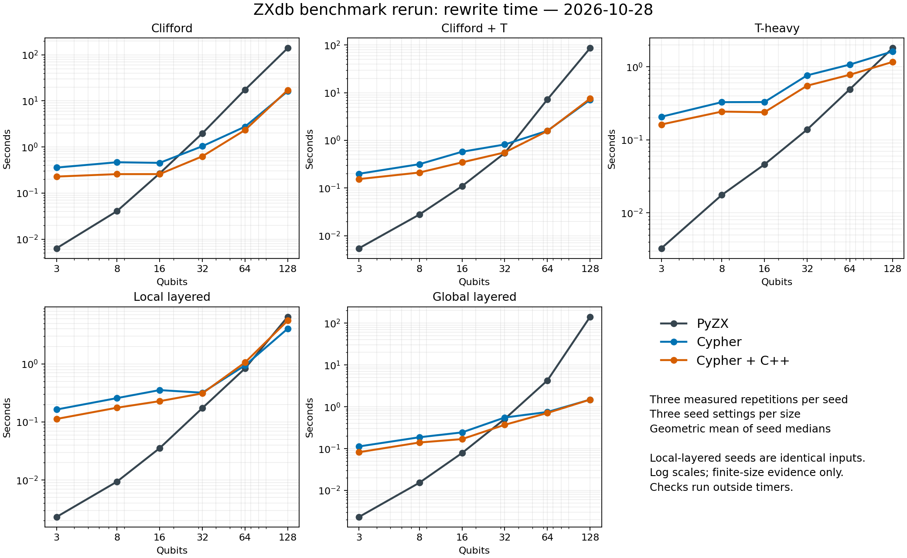
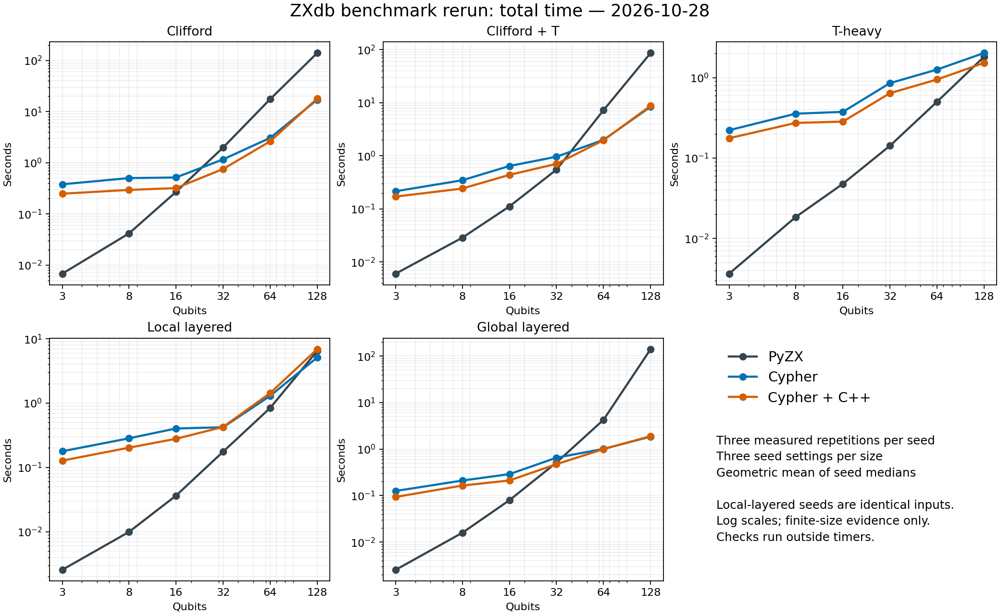

# Benchmark rerun: PyZX, Cypher, and Cypher + C++

Completed 2026-10-28. All 28 implemented performance workload shapes, 160 configurations, 1,440 measured engine trials plus 480 warmups. Three measured repetitions; three seed settings for each circuit size.

**The advantage is workload-dependent.** See the tables below for the measured large-circuit results. Neither database approach wins across all implemented benchmarks, and finite-size measurements do not prove asymptotic superiority. The detailed report includes observed growth exponents between the two largest tested sizes.

Across the 15 individual 128-qubit configurations, Cypher wins 14/15 on rewrite time and hybrid wins 15/15; both win 12/15 on total time. Cypher loses rewrite time on T-heavy seed 2 (0.917× speedup). Cypher loses total time on all three T-heavy seeds; hybrid loses total time on T-heavy seed 0 and local-layered seeds 0 and 1. Family averages below do not replace these per-seed results.

## Large circuits: 128 qubits

Seconds, geometric mean across per-seed medians. Speedup = PyZX/database. Random circuits have depth 2,560; layered circuits have two layers. Local-layered seed settings yield identical inputs.

| Circuit | PyZX rewrite | Cypher rewrite | Hybrid rewrite | Cypher speedup | Hybrid speedup |
|---|---:|---:|---:|---:|---:|
| layered_global | 141.862 | 1.486 | 1.486 | 95.459 | 95.459 |
| layered_local | 6.471 | 4.040 | 5.554 | 1.602 | 1.165 |
| random_clifford | 139.936 | 16.206 | 17.142 | 8.635 | 8.163 |
| random_clifford_t | 86.534 | 7.108 | 7.512 | 12.174 | 11.520 |
| random_t_heavy | 1.806 | 1.624 | 1.166 | 1.112 | 1.548 |

| Circuit | PyZX total | Cypher total | Hybrid total | Cypher speedup | Hybrid speedup |
|---|---:|---:|---:|---:|---:|
| layered_global | 141.871 | 1.855 | 1.901 | 76.498 | 74.616 |
| layered_local | 6.479 | 5.127 | 6.907 | 1.264 | 0.938 |
| random_clifford | 139.954 | 17.064 | 18.019 | 8.202 | 7.767 |
| random_clifford_t | 86.551 | 8.426 | 8.783 | 10.272 | 9.854 |
| random_t_heavy | 1.822 | 2.027 | 1.526 | 0.899 | 1.194 |





## All standalone rules

- cypher: 6/22 largest-scale rule shapes win on rewrite time; 3/22 win on total time.
- hybrid: 7/22 largest-scale rule shapes win on rewrite time; 3/22 win on total time.

These 22 shapes cover eleven rule families as growing neighborhoods and disjoint copies. Identity chains are additionally measured. The [complete report](performance/REPORT.md) lists every family at its largest size and all measured scales. [CSV](performance/timings.csv) retains every individual configuration and seed.

## Correctness

All 91 live regressions passed. The initial fixture run verified 440/446 database outcomes; 6/6 initially inconclusive outcomes passed supplemental exact-zero-tensor or unitary-identity checks. The 446 outcomes are 223 fixtures in both database modes, including QFT and adversarial compositions.

Counts below are per 480 measured output trials for each database mode, including repeated outputs; columns overlap. All remaining tensor comparisons are inconclusive, with no tensor failures. Isomorphism counts include the supplemental audit.

| Engine | Input tensor verified | PyZX tensor verified | Isomorphic | Different structure | Iso unresolved | Equal degrees |
|---|---:|---:|---:|---:|---:|---:|
| cypher | 132 | 141 | 216 | 261 | 3 | 222 |
| hybrid | 132 | 141 | 221 | 256 | 3 | 224 |

There is no blanket semantic certificate for every large output. Degree equality is not semantic proof, and differing structures need not mean a wrong ZX rewrite. Exact isomorphism preserves phases, colors, ordered boundaries and wire multiplicity but excludes global scalar. Tensor checks use projective semantics, up to a nonzero global scalar. All original inconclusive checks are retained alongside supplemental evidence.

## Reproduction and evidence

Run from the repository root against the dedicated empty Memgraph 3.14.0 server with the matching native module:

```powershell
$env:ZXDB_URI='bolt://127.0.0.1:7691'
$env:ZXDB_PYTHON_MODULE='1'
myenv/Scripts/python.exe evaluate.py --quick --variants optimized native --restart-container zxdb-rule-audit --output results/NEW/validation
myenv/Scripts/python.exe -m evaluation.rerun_three_engines --container zxdb-rule-audit --output results/NEW/performance
myenv/Scripts/python.exe -m evaluation.report_three_engines results/NEW/performance
```

The quick flag applies only to the validation run’s extra smoke timings; it does not reduce its correctness fixtures. The separate performance runner always uses the full declared 160-configuration grid by default. Supplemental audit and plotting scripts are saved in this campaign folder and target its sibling performance/validation folders.

- [Integrity checks and source-hash verification](integrity.json)
- [Native module and container provenance](native-provenance.json)
- [Regression and fixture report](validation/REPORT.md)
- [Supplemental fixture checks](validation/supplemental-correctness.json)
- [Supplemental component-isomorphism audit](performance/component-isomorphism.json)
- [Combined correctness counts](combined-correctness.json)
- [Raw timed observations](performance/observations.jsonl)
- [Measured source archive](performance/sources.zip)

Timings are from this rerun only. Verification, snapshot writing, startup and disk I/O are excluded. Total includes graph import/rewrite/export for the database and graph copy/rewrite for PyZX. Matching order and resulting output density affect performance; these are workload-specific measurements, not a complexity proof. The size parameter denotes qubits, copies, or fan size depending on the family. Fan edge counts can grow quadratically; the observed exponents are not normalized by input bytes. Input vertex and edge counts are retained in the CSV.
